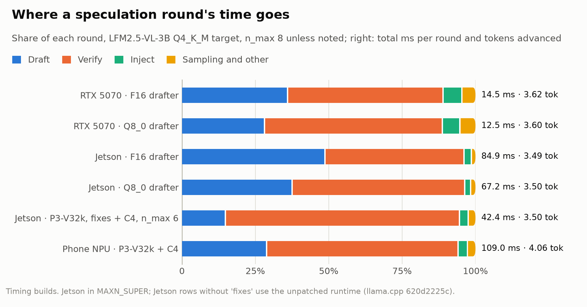
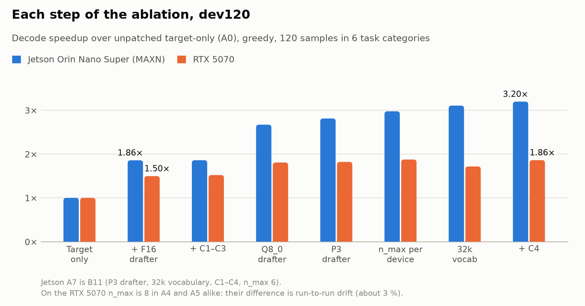
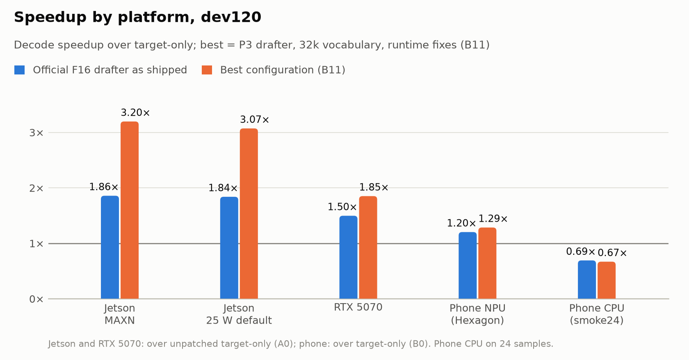
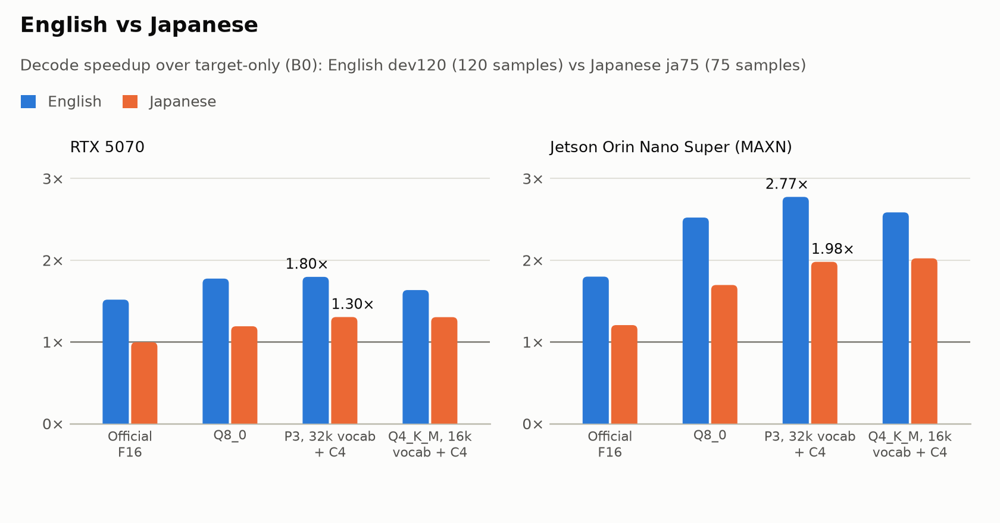
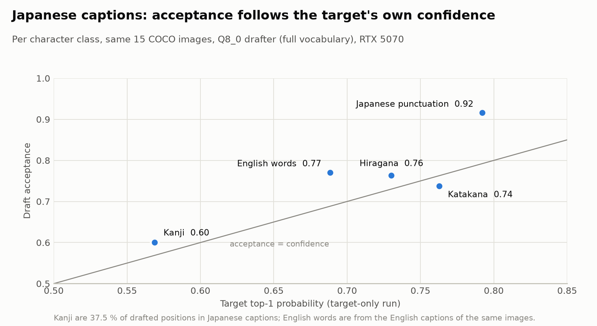

# DSpark on edge devices: where the time goes, and how to deploy it

*Liquid AI LFM2.5-VL-3B with its DSpark speculative-decoding drafter, measured through llama.cpp on an 8 GB Jetson
Orin Nano Super, a Snapdragon 8 Elite phone (Hexagon NPU and CPU) and an RTX 5070. October 2026. All numbers come
from files in `results/summary/`; how to reproduce them is in [`report.md`](report.md), and what they do not show
is in [`limitations.md`](limitations.md).*

## Summary

- **On an 8 GB Jetson the drafter, not verification, is the bottleneck, and inside the drafter it is the Markov
  head.** Its eight serial GEMVs over a 128k-row matrix take about half of the drafter's time on a GPU with a
  2 MB L2. The same matrix fits in a desktop GPU's 48 MB L2, so this cost is invisible in the large-cache
  measurements DSpark has been evaluated on.
- **Fixing it needs no retraining.** A quantized, reduced-vocabulary drafter (exported losslessly from the
  official F16 GGUF), four llama.cpp runtime fixes and a per-device draft length take Jetson decode from
  27.1 t/s (target only) and 50.4 t/s (official drafter as shipped) to **86.6 t/s: 3.20× target-only, 1.72× the
  official drafter**. Outputs are unchanged.
- **The gain depends on the device's verification cost.** Verifying 7–9 tokens costs 1.07× a single-token decode
  on Jetson, 1.6× on the desktop GPU and 1.8× on the phone NPU, so DSpark gives 3.2×, 1.85× and 1.29× there. On
  the phone CPU it slows decoding down.
- **Japanese gets about 70 % of the English gain.** The cause is the target's own uncertainty over kanji word
  choice, amplified by tokenization (1.5 characters per token vs 4.7 in English), not a weaker drafter.

## 1. Where a speculation round's time goes

<picture>
  <source media="(prefers-color-scheme: dark)" srcset="../results/figures/fig1_round_breakdown_dark.png">
  
</picture>

Per-round timing builds (target Q4_K_M, text prompts) split each round into drafting, verification, injecting
target features into the drafter, and sampling:

- **Jetson, unpatched runtime:** with the official F16 drafter, drafting (41.5 ms) costs as much as verification
  (40.2 ms). With a Q8_0 drafter drafting still takes 25.3 ms of a 67 ms round.
- **Inside the drafter** (Nsight, Q8_0): the Markov head's single-column GEMV over `markov_w2` (256 × 128k)
  runs once per draft position, 8 times per round, at 1.67 ms each: about 13.5 ms, or half of the draft time.
  On the RTX 5070 the same GEMV takes 88 µs because the 33 MiB matrix stays in L2. Jetson's 2 MB L2 sends every
  read to DRAM.
- **Verification is cheap on Jetson:** checking 9 tokens takes 39.6 ms against about 37 ms for one token, because
  decode there is memory-bound. That is what makes speculation worth so much on this class of device, once the
  drafter is fast.
- **After the changes in §2** the Jetson round is 42.4 ms, of which drafting is 6.3 ms (15 %).
- **Phone NPU:** verification dominates. One token takes about 40 ms, verifying 3 tokens 52 ms and 5–9 tokens
  67–71 ms: a fixed cost for leaving the single-token path in the Hexagon backend. This caps DSpark there.

## 2. What fixes it

<picture>
  <source media="(prefers-color-scheme: dark)" srcset="../results/figures/fig2_ablation_dark.png">
  
</picture>

Each step on dev120 (120 multimodal samples in six task categories, greedy), as speedup over the unpatched
target-only runtime:

| Step | Jetson MAXN | RTX 5070 |
|---|---:|---:|
| Official F16 drafter (`n_max` 8) | 1.86× | 1.50× |
| + runtime fixes C1–C3 | 1.86× | 1.52× |
| Q8_0 drafter | **2.67×** | 1.81× |
| P3 drafter (decoder Q4_K; projection and Markov head Q8_0) | 2.81× | 1.82× |
| `n_max` 6 on Jetson | 2.98× | — |
| 32k-token draft vocabulary | 3.11× | 1.72× |
| + C4 (Markov chain kept in draft space) | **3.20×** | 1.86× |

- **Quantize the drafter.** Q8_0 keeps acceptance within 1 % of F16 at half the size and is the largest single
  step (+44 % on Jetson).
- **Shrink the drafter's vocabulary, losslessly.** The Markov head and the drafter's output head are sliced to
  the 32k most useful tokens and a `d2t` map is added, which llama.cpp's loader already supports. Both weights are
  quantized along the hidden dimension, so slicing rows is exact: every kept token's logit is bit-identical and
  greedy outputs do not change. What matters is how the vocabulary is ranked: ranking by the target's own answers
  keeps 95.5 % of the full-vocabulary accepted length at 32k, generic corpora only 85 %, because LFM2.5's
  Markdown, LaTeX and special-whitespace tokens are rare in generic text.
- **Fix the runtime.** C1 sends the Markov head's short-K GEMV to the faster MMQ kernel. C2 uses a better MMVQ
  layout on Jetson Orin (target-only decode +15 % for Q4_K_M models; submitted upstream as
  ggml-org/llama.cpp#30858). C3 removes per-token copies introduced upstream in #29622. C4 keeps the Markov chain in
  the draft vocabulary instead of scattering to 128k at every position; without it the reduced vocabulary is a net
  loss on the desktop GPU (about 1.85× → 1.72×).
- **Set the draft length per device:** 6 on Jetson, 8 on the desktop GPU and phone NPU.

In the factory-default 25 W mode the same configuration gives 3.07× (75.9 t/s).

## 3. Across devices

<picture>
  <source media="(prefers-color-scheme: dark)" srcset="../results/figures/fig3_platforms_dark.png">
  
</picture>

- **Jetson** gains most, because verification is nearly free there.
- **The desktop GPU** gains less (1.85×; 1.94× with a Q4_0 target and drafter): verification costs 1.6× a
  single token, and host-side work is a larger share of a 12 ms round.
- **The phone NPU** gets 1.29× [95 % CI 1.15–1.44]. The NPU decodes 1.5× faster than the CPU and processes prompts
  and images more than 8× faster, so it is the right target. Moving the drafter to the GPU or CPU is slower.
  Short-answer tasks (GQA, TextVQA, multiple choice) see 0.83–0.99× on the NPU.
- **The phone CPU** is slower with speculation (0.67–0.69×): it is compute-bound, and drafter and target compete
  for the same cores.

## 4. Japanese

<picture>
  <source media="(prefers-color-scheme: dark)" srcset="../results/figures/fig4_japanese_dark.png">
  
</picture>

On 75 Japanese samples (JMMMU, JA-VLM-Bench-In-the-Wild, JA-VG-VQA-500, ELYZA-tasks-100 and Japanese captions of
the same COCO images), the best configuration gives 1.30× on the RTX 5070 and 1.98× on Jetson, against 1.80× and
2.77× in English. The official F16 drafter gives no gain at all on the desktop GPU (1.00×).

<picture>
  <source media="(prefers-color-scheme: dark)" srcset="../results/figures/fig5_ja_confidence_dark.png">
  
</picture>

A per-round analysis (every draft, accepted count and target token logged) shows where the gap comes from:

- **It depends on the task.** On open-ended text both languages accept equally little (1.40 vs 1.46 draft tokens
  per round). On captions of the same 15 images, Japanese accepts 25 % less (2.34 vs 3.11).
- **Kanji are the weak class:** 37.5 % of drafted positions, acceptance 0.60, against 0.74–0.92 for kana and
  punctuation and 0.77 for English words.
- **The target is uncertain there, not the drafter.** The target's own top-1 probability on kanji is 0.57, and in
  every character class acceptance tracks the target's confidence the same way in both languages. The uncertainty
  is spread over many candidates (top-2 mass 0.71), so two-candidate tree drafting would not help kanji more than
  English.
- **Tokenization multiplies the effect:** 1.5 characters per token in Japanese against 4.7 in English means about
  three times as many uncertain decisions for the same caption.

A language-specific vocabulary helps a little: a 16k vocabulary ranked with Japanese weight matches the 32k one on
Japanese (Jetson 2.02× vs 1.98×) and is slower on English.

## 5. Recommendations

For DSpark and the LFM2.5 releases:

1. **Ship an edge variant of the DSpark drafter:** P3 quantization plus a 32k vocabulary ranked by the target's
   own outputs, with an I32 `d2t`. It needs no retraining and leaves outputs unchanged. On an 8 GB Jetson, on the
   same patched runtime and with `n_max` 6, it decodes 1.67× faster than the current F16 drafter at its default
   `n_max` 8 (1.72× with the draft-space Markov chain, C4). A Japanese-weighted 16k variant suits Japanese products.
2. **Account for the Markov head on small-cache devices** in future drafter designs: its cost scales with
   vocabulary × rank × block length and is serial per position. A smaller head vocabulary, or fewer serial steps
   per round, matters most exactly where speculation pays most.
3. **Do not expect English speedups in Japanese.** More Japanese drafter training is likely to help less than
   expected, because the ceiling is the target's uncertainty over kanji. Tokenizer changes (more whole-word kanji
   tokens) or retrieval-style drafting for repeated names are the more promising levers; neither is tested here.

For deployment on llama.cpp:

4. Quantize the drafter (Q8_0 or P3); set `n_max` per device; on 8 GB boards set `--cache-ram 0` (the 8 GiB
   default host prompt cache does not fit).
5. On phones use the Hexagon NPU for target and drafter, and do not enable speculation on the CPU. Raising DSpark
   on the NPU above 1.3× needs a cheaper multi-token verification path in the Hexagon backend.
6. **Expect the Hexagon NPU's output to depend on batch shape, with or without speculation.** Its single-token and
   multi-token paths give clearly different logits: evaluating the same prompts with a physical batch of 2 instead
   of 1 moves next-token logprobs by up to 2.6 (up to 4.3 for larger batches) and changes the top-1 token in 1–3
   of 10 prompts, against at most 0.06 for F16 and 0.6 for quantized weights on CUDA. So prompt chunking alone can
   change the NPU's greedy output, and speculative output there differs from target-only output more often and at
   larger margins than on the GPUs (`limitations.md` §1). This belongs with the verification-cost issue above in
   feedback to the Hexagon backend; evaluations on the NPU should not assume run-to-run equality across batch
   settings.

## 6. Correctness

Speculative greedy output was compared with target-only greedy output on the same target on all three platforms
(`limitations.md` §1): a 30-configuration matrix on the RTX 5070 and the 24-sample multimodal set on each device.

- **For a given target and draft length, every drafter variant, including the reduced-vocabulary one, produces
  the same output.** The speedups above come with no change to what the model says relative to the official
  drafter.
- **Against target-only decoding, outputs can differ at near-ties**, because verification evaluates several tokens
  at once and llama.cpp's kernels are not batch-invariant. On the RTX 5070 and Jetson every divergence is a
  near-tie (top-1/top-2 margin below 0.26). F16 targets match exactly except two ties at margins of 0.0036 and
  0.0011 in 44 multimodal samples.
- **On the phone the protocol's criteria are not met.**
  - On the Hexagon NPU, 6 of 24 samples diverge at margins of 0.39–0.65. Changing only the batch size, with no
    speculation, already moves logprobs by up to 4 and flips top-1 tokens there.
  - On the CPU at `n_max` 1, long-context (image) prompts diverge where the CPU's batch-2 path stops being
    bit-exact.
  - In both cases the speculative output is still the target's own choice, typically its second candidate.
